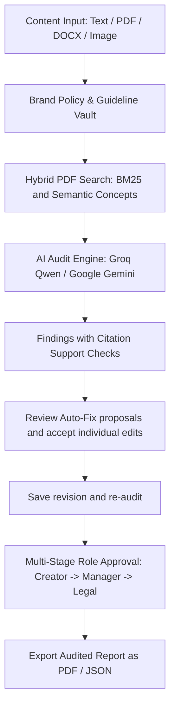

# BrandGuard AI 🛡️
### *AI-Powered Brand Governance, Content Compliance & Real-Time RAG Safety Engine*

[](https://github.com/GitKrishna-source/BrandGuard)
[](https://fastapi.tiangolo.com/)
[](https://react.dev/)
[](https://tailwindcss.com/)
[](https://groq.com/)

---

## 💡 1. Basic Idea of the Project

When marketing teams, copywriters, or generative AI create content (product announcements, press releases, social ads, blogs, or investor disclosures), critical mistakes often slip through:
- **Unsupported & Absolute Claims:** *"100% bug-free"*, *"#1 ranking in the world"*, or fabricated financial metrics (violating legal and SEC regulations).
- **Prohibited Slang & Banned Nomenclature:** Outdated product names, slang (e.g., *"kicks"* instead of *"shoes"*), or unapproved customer support designations.
- **AI Hallucinations:** Fabricated certifications, fake ISO endorsements, or incorrect pricing/warranty terms.
- **Tone & Style Drift:** Inconsistent voice, non-compliant brand colors, or broken image accessibility.

**BrandGuard AI** ingests company brand guidelines, audits drafts using **Local PDF RAG + Groq/Gemini LLM reasoning**, and reports findings with **page-level citations**. **Auto-Fix review** proposes changes with a before-and-after comparison and individual accept/reject controls. Revised copy needs re-auditing and human approval; an automated score is not a compliance guarantee.

---

## 🔄 2. Project Flow (How It Works)



1. **Content Input:**
   - Paste custom copy, upload creative assets (PDF, DOCX, PNG/JPG images), or load the interactive **Bootwear Brand Guidelines** demo.
2. **Hybrid PDF retrieval**
   - BrandGuard ranks page-labelled passages using BM25 keyword matches and shared concepts. For example, “banishes aching feet” can retrieve a policy on pain-relief claims.
3. **Deep LLM Audit:**
   - The draft and retrieved evidence are evaluated by **Groq (`qwen/qwen3.8-27b`)** or **Google Gemini**.
   - Findings show the draft excerpt, page citations, and whether each citation supports the conclusion. Expand the evidence check to see the reason and the exact passage quote.
4. **Auto-Fix review (Remediation):**
   - Click **"Review Auto-Fix edits"** to compare the original and proposed draft, inspect each change's explanation, and accept or reject it individually.
   - **"Use accepted edits"** changes only the selected wording. **"Undo Fix"** restores the previous draft; save a revision and re-audit to assess it.
5. **Human Governance & Approval Pipeline:**
   - Role-based permissions (**Creator**, **Manager**, **Legal**).
   - Real-time review comments, approval sign-offs, and compliance history.
6. **Report Export:**
   - Download verifiable audit certificates in **PDF** or **JSON** format with recorded review logs.

---

## ⚡ 3. How to Start the Server with ONE Line

You can launch both the **FastAPI Backend (port 8000)** and the **React + Vite Frontend (port 3000)** concurrently using a single command:

```powershell
npm run dev
```

*(Alternatively, you can run `npm start`, execute `.\start.ps1`, or double-click `start.bat` in File Explorer).*

### What happens behind the scenes:
- Terminal shows color-coded prefixes: `[BACKEND]` (cyan) and `[FRONTEND]` (magenta).
- Backend runs at: **[http://localhost:8000](http://localhost:8000)** (Swagger API Docs: `http://localhost:8000/docs`)
- Frontend runs at: **[http://localhost:3000](http://localhost:3000)**
- Pressing `Ctrl + C` cleanly stops both servers together.

---

## 🔗 4. GitHub Repository Link

- **Official Repository:** [https://github.com/GitKrishna-source/BrandGuard](https://github.com/GitKrishna-source/BrandGuard)

---

## 🛠️ 5. Technology Stack

| Layer | Technologies |
|---|---|
| **Frontend** | React 18, TypeScript (strict), Vite, Tailwind CSS, Lucide Icons, Canvas Confetti |
| **Backend** | Python 3.11+, FastAPI, SQLAlchemy, Uvicorn, Pydantic v2 |
| **AI & RAG** | Groq Cloud, Google Gemini, local BM25 and semantic concept retrieval |
| **Parsers** | `pypdf` (PDF), `python-docx` (Word), `Pillow` (Image & Palette), `reportlab` (PDF generation) |
| **Security & Auth** | JWT Bearer tokens, Argon2 password hashing, Role-Based Access Control (RBAC) |
| **Database** | SQLite (local development) / PostgreSQL (production Docker Compose ready) |
| **Testing & Quality** | Pytest, 40-case audit reliability benchmark, edit-selection tests, ESLint, Ruff, GitHub Actions |

---

## 🧪 6. Quick Verification Guide

1. Open **[http://localhost:3000](http://localhost:3000)** in your browser.
2. Click **"Demo Login"** and pick the **Creator** or **Manager** role.
3. Click **"Try a Sample Audit"** to load the Bootwear PDF, then choose **"Try paraphrased claims"**.
4. Click **"Run Audit"** and expand a finding's evidence check. The paraphrase demo works with `AI_PROVIDER=local` and no API key.
5. Click **"Review Auto-Fix edits"**, inspect the comparison and explanations, then accept or reject individual changes and choose **"Use accepted edits"**.
6. Click **"Save Revision & Re-audit"** to assess the revised draft. Remaining findings still need attention and human review.
   


    
