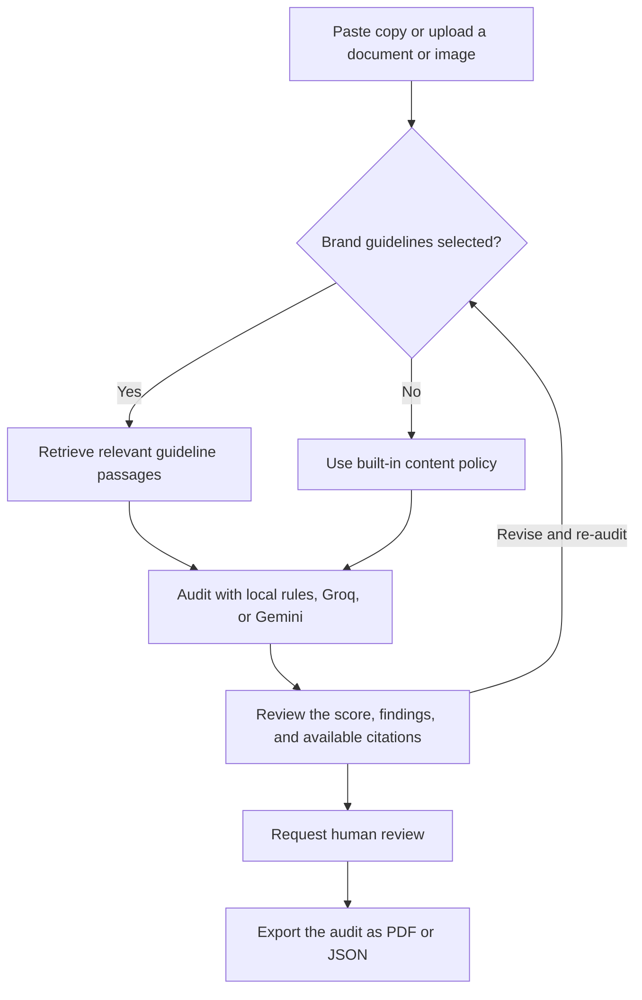

# BrandGuard AI

BrandGuard AI helps marketing teams review copy, documents, and images before publication. It flags issues such as unsupported claims, unapproved terminology, and missing image descriptions. The React frontend sends audits to a FastAPI backend that can run locally without an AI API key.

## Project workflow



When guidelines are selected, BrandGuard uses BM25 keyword matching and concept matching to retrieve and cite relevant passages. Auto-Fix lets you accept individual edits before saving and re-auditing a revision. Managers and Legal reviewers can request changes or approve a draft. A draft with a high-severity finding requires Legal approval.

[Run locally](#run-locally) · [Demo login and walkthrough](#try-the-demo) · [Connect WordPress](#connect-wordpress-optional) · [Configure an AI provider](#configure-an-ai-provider) · [Run checks](#development-checks) · [Troubleshooting](#troubleshooting)

## Run locally

### 1. Install the prerequisites and clone the repository

- **Node.js 22.20 or later in the 22.x line**, with npm.
- **Python 3.11 or newer**. Python 3.11 is used in CI and Python 3.12 is used in the Docker image.
- **Git** to clone the repository.

```sh
git clone https://github.com/GitKrishna-source/BrandGuard.git
cd BrandGuard
```

The default local stack uses SQLite and can run audits without an AI API key. Keep both the frontend and backend running while using the app.

### 2. Install dependencies and create the environment files

Run the block for your operating system from the repository root. The copy commands are for first-time setup. Keep your existing `.env` files if you have already configured the app. The templates are [`.env.example`](.env.example) for the frontend and [`backend/.env.example`](backend/.env.example) for the backend.

**Windows (PowerShell)**

```powershell
npm ci
python -m venv backend/.venv
.\backend\.venv\Scripts\python.exe -m pip install -e "./backend[dev]"
Copy-Item .env.example .env
Copy-Item backend/.env.example backend/.env
```

If PowerShell blocks `npm.ps1`, use `npm.cmd` in place of `npm` in the commands below. The Python commands call the virtual environment directly, so activation is optional.

**macOS and Linux**

```bash
npm ci
python3 -m venv backend/.venv
backend/.venv/bin/python -m pip install -e "./backend[dev]"
cp .env.example .env
cp backend/.env.example backend/.env
```

Open `backend/.env` and change the existing `AI_PROVIDER` line to `AI_PROVIDER=local` for a keyless first run. Keep `DEMO_LOGIN_ENABLED=true` to use the role picker. The copied frontend file points to `http://localhost:8000`.

### 3. Start both servers

**Windows combined launcher**

From the repository root, run:

```powershell
npm run dev
```

The launcher uses Windows PowerShell and `backend/.venv`. It starts both servers in one terminal with `BACKEND` and `FRONTEND` log prefixes. `npm start`, `.\start.ps1`, and `start.bat` also invoke it. Press **Ctrl+C** to stop the servers.

**Separate terminals on Windows, macOS, or Linux**

In the first terminal, start the backend from the repository root.

```powershell
# Windows PowerShell
cd backend
.\.venv\Scripts\python.exe -m uvicorn app.main:app --reload --port 8000
```

```bash
# macOS and Linux
cd backend
.venv/bin/python -m uvicorn app.main:app --reload --port 8000
```

In the second terminal, stay in the repository root and start the frontend.

```sh
npm run dev:frontend
```

Press **Ctrl+C** in each terminal to stop its server.

### 4. Open the app

| Service | Local URL |
| --- | --- |
| React app | [http://localhost:3000](http://localhost:3000) |
| FastAPI health check | [http://localhost:8000/health](http://localhost:8000/health) |
| Interactive API documentation | [http://localhost:8000/docs](http://localhost:8000/docs) |

The health check should return `"status": "ok"`. The backend creates the tables and `backend/brandguard.db` on startup with the commands above. Audits, guideline sources, revisions, and reviews persist in that SQLite file across restarts.

## Try the demo

1. Open the app and choose **Creator** in **Demo Login**. To audit your own copy, choose **Launch Audit**, paste a draft, and click **Run Audit**. The general audit uses built-in rules without any brand setup.
2. To try an audit with citations, click **Try the Bootwear PDF demo** on the home page or **Use Bootwear PDF** in the audit studio. Bootwear is a fictional shoe brand with bundled guidelines.
3. Click **Try paraphrased claims**, then **Run Audit**. Expand a finding's evidence check to see the page, passage, and reason for the citation assessment.
4. To try Auto-Fix in local mode, choose **Load Bootwear test draft**, click **Save Revision & Re-audit**, and open **Review Auto-Fix edits**. Review the proposed changes, accept the edits you want, and select **Use accepted edits**. **Undo Fix** restores the prior wording. Click **Save Revision & Re-audit** again to score the revised draft.
5. Switch to **Manager** or **Legal** using the account button. Open **Reviews** to select a saved audit, add a comment, request changes, or approve it. An audit with a high-severity finding requires Legal approval.
6. Select **Export saved audit** in the studio or **Export this audit** in Reviews. Download the saved record as PDF or JSON.

### Try the WordPress draft demo

1. Open **Demo Login → Try WordPress demo**. BrandGuard signs you in as Creator and opens an imported sample draft. If you already have the studio open, use **Import WordPress Draft → Import sample draft**.
2. Click **Run Audit** to see the findings. Edit the draft or review and accept Auto-Fix edits, then click **Save Revision & Re-audit**.
3. Click **Sync to Demo Draft** to see the audit reference, then **View saved demo draft** to inspect the revised copy. BrandGuard saves the audit and revision in the API. The simulated WordPress draft stays in the current studio session and resets on reload.

For a public judge deployment, set `DEMO_LOGIN_ENABLED=true`, `WORDPRESS_LIVE_ENABLED=false`, and `AI_PROVIDER=local` in the backend environment. Use a database dedicated to the demo.

### Import your own guidelines

Sign in as **Manager** or **Legal** and open **Brand Vault**. Upload a text-based or scanned PDF, or a PNG or JPEG guideline image. The backend extracts page text and runs local OCR where needed. Review the extracted text, correct it or retry OCR on a page, enter the brand name, and select **Confirm & Add to Brand Sources**. Select that source in the audit studio to use it for your next audit.

Guideline uploads have a default 10 MB limit. PDFs can have up to 100 pages, and imports can contain up to 250,000 extracted characters. At least one page needs usable text. For the draft itself, the studio accepts pasted text, PDF, DOCX, UTF-8 TXT and Markdown files, and supported images such as PNG and JPEG.

## Connect WordPress (optional)

Use a WordPress site reachable by the backend over HTTPS and an account with permission to read and edit the draft. This integration is configured in the audit studio.

1. In WordPress Admin, open **Users → Profile** and create an **Application Password** labeled `BrandGuard`. Copy the generated password. [WordPress Application Passwords guide](https://developer.wordpress.org/advanced-administration/security/application-passwords/)
2. In BrandGuard, open **Launch Audit** and select **Import WordPress Draft**. Enter the site's base URL, your WordPress username, and the Application Password. Select **Connect & Fetch Drafts** and choose an unpublished post.
3. Audit the latest revision and select **Sync to WordPress Draft**. This replaces the linked draft body and adds a hidden audit reference. Sync checks that the post is still a draft and compares the modification timestamp with the imported version.

BrandGuard keeps the WordPress credentials in memory for the current studio session. **Disconnect** clears the Application Password and unlinks the live draft. Sync is a separate action from BrandGuard's human review workflow.

On the hosted judge demo, set `VITE_WORDPRESS_DEMO_APP_PASSWORD` in the frontend host's production environment and redeploy. The WordPress connection form displays the Speak Thing site URL, username, and Application Password with a **Copy** button for each. Use a demo-only credential because visitors to the site can read it.

For a local judge demo, set `VITE_WORDPRESS_DEMO_SITE_URL`, `VITE_WORDPRESS_DEMO_USERNAME`, and `WORDPRESS_DEMO_APP_PASSWORD` in the ignored `.env.development.local` file. Quote the Application Password to preserve its spaces, then restart Vite.

## Configuration

| File | Setting | Local value or purpose |
| --- | --- | --- |
| `.env` | `VITE_API_BASE_URL` | `http://localhost:8000`, the API URL the browser calls. |
| `backend/.env` | `FRONTEND_ORIGIN` | `http://localhost:3000`, the exact frontend origin allowed by CORS. |
| `backend/.env` | `DATABASE_URL` | `sqlite:///./brandguard.db`. This relative path resolves from the backend process's working directory. PostgreSQL is also supported. |
| `backend/.env` | `DEMO_LOGIN_ENABLED` | `true` enables one-click Creator, Manager, and Legal sessions. |
| `backend/.env` | `WORDPRESS_LIVE_ENABLED` | Set to `false` for a public demo with only the sample draft. |
| `backend/.env` | `AUTH_SECRET` | Signing secret for JWTs. Use a long random value for a shared instance. |
| `backend/.env` | `ACCESS_TOKEN_EXPIRE_MINUTES` | `30` by default. |
| `backend/.env` | `AUTH_USERS_JSON` | Account records for password login via the API. The web role picker uses demo login. |
| `backend/.env` | `AI_PROVIDER` | `local`, `groq`, or `gemini`. The example file starts with `groq`. |
| `backend/.env` | `MAX_UPLOAD_BYTES` | Defaults to `10000000` (10 MB). |

Restart the affected server after editing an environment file. Process environment variables take precedence over `backend/.env`. Vite reads `VITE_API_BASE_URL` when the dev server starts or when you build the frontend.

### Configure an AI provider

Local mode uses deterministic rules for common issues and recognized claim concepts. For contextual interpretation of guidelines, broader writing feedback, or AI image review, select a provider in `backend/.env`.

- **Groq** — Set `AI_PROVIDER=groq` and `GROQ_API_KEY`. Set `GROQ_MODEL` to a text model available to your account. For image audits, set `GROQ_VISION_MODEL` to a vision-capable model.
- **Gemini** — Set `AI_PROVIDER=gemini`, `GEMINI_API_KEY`, and `GEMINI_MODEL` to a model that supports the content types you want to audit.

Keep provider keys in `backend/.env`. The selected provider may receive the draft, image, and relevant guideline passages. If the key is missing or the provider request fails, the audit falls back to local checks and records that in the saved audit. With `AI_PROVIDER=local`, drafts stay in the local app and its database.

### Optional Docker backend and PostgreSQL

With Docker Compose installed, add `AUTH_USERS_JSON={}` to `backend/.env` for a demo-only local instance and set `AUTH_SECRET` to a long random value. Compose requires both values. Keep `DEMO_LOGIN_ENABLED=true` and `AI_PROVIDER=local` for the keyless demo.

```sh
cd backend
docker compose up --build
```

Compose runs the API on port 8000 and PostgreSQL on port 5432. PostgreSQL data persists in the `brandguard-postgres` volume. Start the frontend separately from the repository root with `npm run dev:frontend`. Run `docker compose down` from `backend` to stop the containers.

## Technology stack

| Area | Implementation |
| --- | --- |
| Frontend | React 18, TypeScript, Vite, Tailwind CSS. UI in [`src/components/`](src/components/) and the HTTP client in [`src/lib/api.ts`](src/lib/api.ts). |
| API and auth | FastAPI, Pydantic, Uvicorn, JWT bearer sessions, and Argon2 password hashing. Endpoints in [`backend/app/main.py`](backend/app/main.py). |
| Storage | SQLAlchemy with SQLite for local development and PostgreSQL in [Docker Compose](backend/docker-compose.yml). |
| Extraction and retrieval | pypdf, pypdfium2, RapidOCR with ONNX Runtime, python-docx, and Pillow. Guideline processing in [`ocr.py`](backend/app/ocr.py) and [`retrieval.py`](backend/app/retrieval.py). |
| Analysis and reports | Local rules with optional Groq or Gemini analysis in [`services.py`](backend/app/services.py). ReportLab renders PDF exports. |
| WordPress | Draft import and sync through the WordPress REST API in [`wordpress.py`](backend/app/wordpress.py). |
| Tests and CI | [Frontend tests](tests/), [backend tests](backend/tests/), a [40-case audit benchmark](backend/evals/README.md), and [GitHub Actions](.github/workflows/). |

See the [backend reference](backend/README.md) for endpoint behavior, source retention, report contents, and evaluation details.

## Development checks

From the repository root:

```sh
npm run typecheck
npm run lint -- --ignore-pattern "backend/.venv/**"
npm run test:remediation
npm run build
```

The lint flag keeps ESLint out of the Python virtual environment. The production frontend build is written to `dist/`. To preview it locally, stop the Vite dev server, keep the backend running, and use `npm run preview -- --port 3000 --strictPort`.

Run backend checks in a fresh terminal from the repository root. The test command uses local analysis and writes to `backend/brandguard-test.db`. The auth tests use the default demo accounts.

```powershell
cd backend
$env:AI_PROVIDER = "local"
$env:DATABASE_URL = "sqlite:///./brandguard-test.db"
.\.venv\Scripts\python.exe -m pytest -q
.\.venv\Scripts\python.exe -m app.evaluation --check --output ../output/evals/audit-reliability.json
```

```bash
cd backend
AI_PROVIDER=local DATABASE_URL=sqlite:///./brandguard-test.db .venv/bin/python -m pytest -q
.venv/bin/python -m app.evaluation --check --output ../output/evals/audit-reliability.json
```

The benchmark runs local checks against 40 labeled text cases and writes a JSON report with per-case results. See the [evaluation guide](backend/evals/README.md) for metrics and the optional live-provider benchmark.

## Troubleshooting

| Symptom | What to check |
| --- | --- |
| `npm`, `python`, or `python3` is unavailable | Check the runtime version in a new terminal after installation. In Windows PowerShell, try `npm.cmd` if the error mentions script execution policy. |
| `concurrently` or `vite` is missing | Run `npm ci` from the repository root. |
| Uvicorn or a Python module is missing | Create `backend/.venv` and install `./backend[dev]` with that environment's Python. Launch Uvicorn from `backend/`. |
| The page opens but login or auditing fails | Check [the API health endpoint](http://localhost:8000/health), then verify `VITE_API_BASE_URL` and `FRONTEND_ORIGIN`. The origin must match the browser's scheme, host, and port, including the choice between `localhost` and `127.0.0.1`. |
| A default port is in use | Stop the other service or select a free port in the separate-terminal commands. Update `VITE_API_BASE_URL` for an API port change or `FRONTEND_ORIGIN` for a frontend port change. Restart the affected servers. Vite can automatically pick another port, so check the URL printed in its terminal. |
| Demo login returns HTTP 403 | Set `DEMO_LOGIN_ENABLED=true` in `backend/.env` and restart the API. Sign in again if your token expires. |
| The audit falls back to local checks | Check the backend log for details. Confirm the provider selection, key, model access, and quota. |
| Scanned pages have missing or low-confidence text | In the guideline preview, use **Retry Enhanced OCR** or correct the page text before saving. Check the backend log if OCR fails to initialize. |
| WordPress cannot connect or shows an empty draft list | Check the base URL and confirm the backend can reach its `/wp-json` endpoint. Verify the Application Password, the account's access to the draft, and the post's draft status. |
